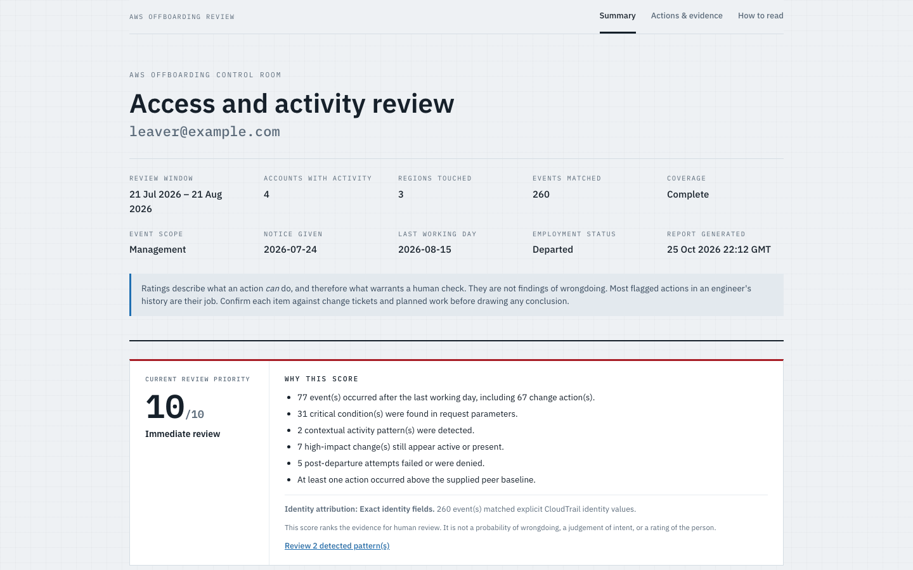
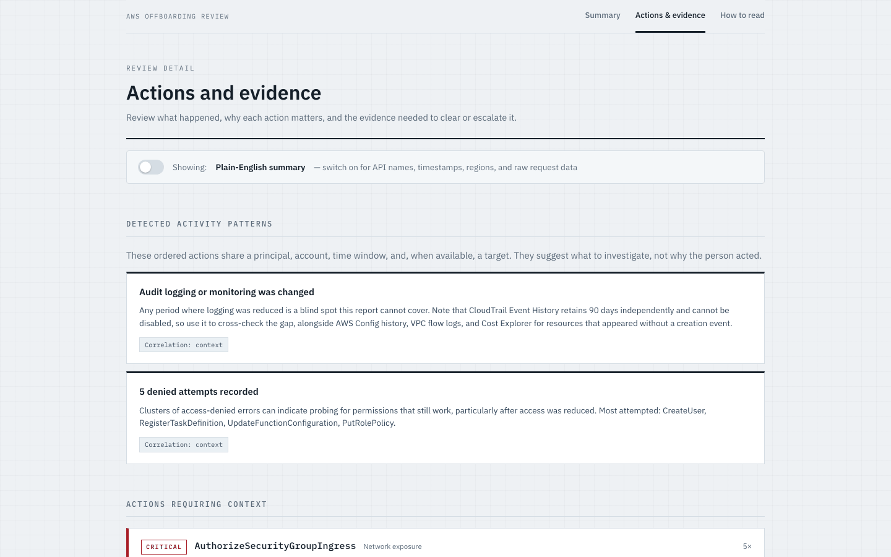
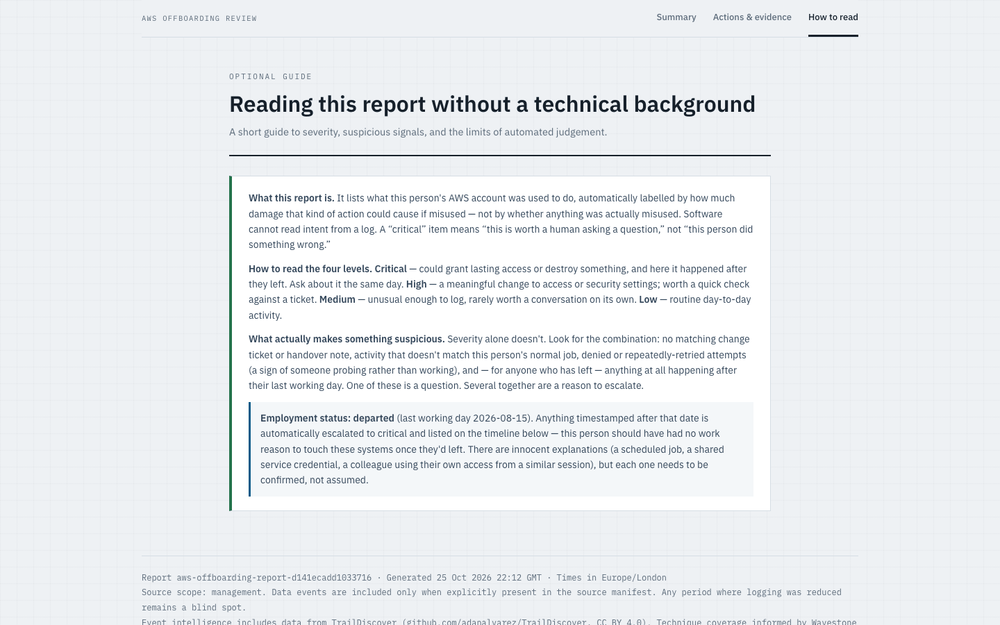
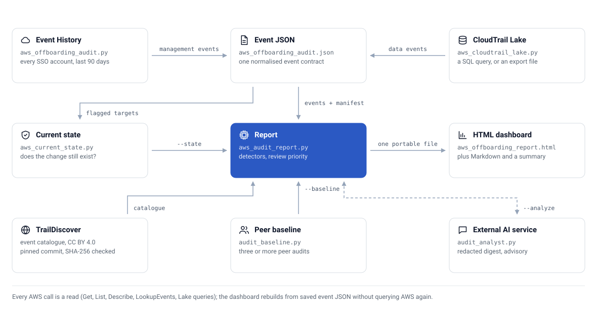

<div align="center">


# 🛡️ AWS Offboarding Audit

**For security and IT teams: see what a departing engineer did in every AWS account, in one local report, with read-only access**


[](LICENSE)
[](https://github.com/CaputoDavide93/AWS-OffBoarding-Audit/actions/workflows/security.yml)

[Why](#-why-it-exists) • [Quick Start](#-quick-start) • [Features](#-features) • [Screenshots](#-screenshots) • [Architecture](#️-architecture) • [Tested on](#-supported-and-tested-on) • [Docs](#-documentation) • [Contributing](#-contributing)

</div>

---

## 🎯 Why it exists

When an engineer leaves, someone has to answer one question: did they leave anything behind, and did they touch anything on the way out? In AWS that means searching CloudTrail in every account and region, reading request parameters for trust policies, public snapshots and new keys, and working out what still exists. By hand it is slow, and it is easy to miss an account.

This tool does that review in one run. It discovers every account your IAM Identity Center sign-in reaches, collects the person's CloudTrail events, flags the changes that can give lasting access or destroy something, and writes one HTML report that opens locally. The report starts in plain English for HR or an IT lead and has a switch for the technical detail.

A fully synthetic report is in [docs/assets/example-report.html](docs/assets/example-report.html). Download it and open it locally to see the output before you run anything; no account ID in it is real.

| | This tool | Searching CloudTrail by hand | Your own queries over CloudTrail logs |
|---|---|---|---|
| Accounts per run | Every account the SSO sign-in reaches | One account and region at a time | Whatever your trail and tables cover |
| Setup | An SSO sign-in and a read-only role | None | A trail, a table and queries you write and keep |
| Request parameters | Built-in checks for external trust, wildcard policies, public resources, long-lived keys, open security groups, logging changes | You read the JSON | You write the checks |
| Timing | Separates notice period from after the last working day | You compare dates | You write it |
| Does the change still exist | Optional read-only reconciliation | You look it up | Not in the logs |
| Changes anything in AWS | Never: read calls only | No | No |
| Output | One offline HTML file, plus Markdown and JSON | Console screens | Query results |

The main trade-off: it works from CloudTrail Event History by default, which holds 90 days of management events only. Longer ranges and data events need CloudTrail Lake. Its ratings are review priorities for a human, not findings of intent.

---

## 🚀 Quick Start

You need Python 3.10 or newer. For a real run you also need IAM Identity Center access with a read-only permission set such as `SecurityAudit` in each account. You can try the tool first without AWS access.

**1. Install**

```bash
python3 -m venv .venv
.venv/bin/python -m pip install -r requirements.txt
```

**2. See it on synthetic data**

```bash
mkdir -p working
python3 tests/fixtures/gen_sample.py
.venv/bin/python src/aws_audit_report.py sample.json \
  --user leaver@example.com --notice-date 2026-07-24 --last-day 2026-08-15 \
  --org-accounts 111122223333 444455556666 777788889999 222233334444 \
  --out working/demo --open
```

**3. Run it on your organisation**

```bash
cp audit-config.example.yaml audit-config.yaml     # then edit it; Git ignores it
aws sso login --sso-session <your-session-name>
.venv/bin/python src/aws_offboarding_dashboard.py --config audit-config.yaml --preflight
```

Preflight lists the accounts and writes the plan without querying CloudTrail. When the list is right, drop `--preflight` and add `--user`, `--notice-date`, `--last-day` and `--out working/aws_offboarding_report`. Add `--resume` after an interrupted collection. The numbered walkthrough, with a screenshot per step, is in [docs/setup.md](docs/setup.md).

Generated evidence is ignored by Git when it sits in `working/`.

---

## 👁️ Read-only, by design

Every AWS call this project makes reads state; none changes it. The complete list:

| Service | Calls |
|---|---|
| IAM Identity Center | `ListAccounts`, `ListAccountRoles`, `GetRoleCredentials` (short-lived sign-in to each account) |
| CloudTrail | `LookupEvents`, `GetTrailStatus` |
| CloudTrail Lake | `StartQuery`, `GetQueryResults` (runs a SQL query over the event data store; it stores nothing) |
| IAM | `GetUser`, `GetRole`, `ListAccessKeys` |
| EC2 | `DescribeRegions`, `DescribeSecurityGroups`, `DescribeSnapshots`, `DescribeSnapshotAttribute` |
| RDS | `DescribeDBInstances`, `DescribeDBClusters` |
| KMS | `DescribeKey` |
| Lambda | `GetFunction`, `GetFunctionUrlConfig` |
| S3 | `HeadBucket`, `GetBucketReplication`, `GetBucketLifecycleConfiguration` |

There is no `Create*`, `Put*`, `Delete*`, `Update*`, `Terminate*`, `Modify*`, `Attach*`/`Detach*`, or
`Revoke*` call anywhere in this codebase. Running it cannot alter, disable, or delete anything in your
AWS accounts.

Three things reach beyond AWS:

- **TrailDiscover catalogue:** `aws_audit_report.py` downloads it from GitHub
  (`raw.githubusercontent.com`) at a pinned commit, verifies it by SHA-256, and caches it for seven
  days. `--no-enrich` skips it.
- **Anthropic API:** only with `--analyze` (see [Usage](#-usage)). It
  sends a bounded findings digest, never raw logs, with account IDs and IP addresses hashed by default.
- **Google Fonts:** the HTML dashboard links IBM Plex from `fonts.googleapis.com`, so the browser
  that opens the report fetches it. The script itself makes no such call.

---

## ✨ Features

| | Feature | What it does |
|---|---|---|
| 🔎 | Exact identity matching | Matches across SSO usernames, session ARNs, principal IDs, IAM usernames, and Identity Center session issuers |
| 🌍 | Cross-account collection | Per-account and per-region coverage, failures, denials, and resumable checkpoints |
| 🧩 | Parameter inspection | Checks request parameters for external trust, wildcard policies, public resources, long-lived credentials, open security groups, destructive lifecycle rules, and logging changes |
| 🔗 | Bounded sequence correlation | Links ordered activity from the same principal, account, target, and time window, with optional two-hypothesis AI interpretation |
| 📊 | Paged interactive dashboard | A 1-10 evidence review priority plus search and severity, account, category, date, and current-state filters |
| 🧭 | Plain-language assessments | Separates likely routine activity, items to watch, and evidence that needs prompt investigation without claiming to infer intent |
| 👔 | HR-facing by default | A non-technical explainer opens first, framed by employment status (employed, on notice, or departed), with a switch to reveal full technical detail on demand |
| 📋 | Evidence-aware readiness checklist | Separates report-backed checks from manual identity, credential, session, secret-rotation, and handover controls |
| ✅ | Read-only reconciliation | Checks IAM users and roles, Lambda URLs, snapshots, buckets, security groups, KMS keys, databases, and CloudTrail trails |
| 📈 | Peer baselines | Built from comparable historical or colleague audit files |
| 🗄️ | CloudTrail Lake support | Queries management and data events when the event data store records them |
| 🕵️ | Privacy by default | Identifiers are redacted before any analyst call (`--no-redact` to opt out) and analyst web search is opt-in (`--search`) |
| 📌 | Pinned threat intel | The TrailDiscover dataset is pinned to a reviewed commit and hash-verified, so upstream changes never silently alter report wording |
| 🔐 | Secret-safe workflow | Ignored evidence files, pre-commit and pre-push Gitleaks checks, and optional `age` encryption for archives |

---

## 📸 Screenshots

Taken by `make screenshots` from the synthetic sample: no real accounts or people. The report has a single light theme.







---

## 🗺️ Architecture

<picture>
  <source media="(prefers-color-scheme: dark)" srcset="docs/assets/architecture-dark.svg">
  
</picture>

Collection and reporting remain separate. You can rebuild the dashboard from saved event JSON
without querying AWS again. Current state, the peer baseline and the external analysis are optional
inputs to the report, passed with `--state`, `--baseline` and `--analyze`.

---

## ✅ Supported and tested on

| Environment | Status |
|---|---|
| Python 3.11 on Linux (GitHub Actions) | Tests, lint, secret scan and diagram check run on every push |
| Python 3.14 on macOS | Tests and `make screenshots` run locally |
| Python 3.10 | Supported by the code; not run in CI |
| Windows | Untested |
| Real AWS organisation, Event History | Unverified by the automated tests |
| CloudTrail Lake | Unverified by the automated tests; `--dry-run` shows the SQL first |

Tell us what you run it on: see [Contributing](#-contributing).

---

## 📖 Usage

The README covers the first run. Each task below has a recipe in the [how-to guide](docs/howto-guide.md):

| Task | Where |
|---|---|
| Check whether a flagged change still exists | [Reconcile current state](docs/howto-guide.md#reconcile-whether-a-flagged-change-still-exists) |
| Compare against peers | [Peer baselines](docs/howto-guide.md#compare-against-peer-or-historical-baselines) |
| Query CloudTrail Lake | [Lake queries](docs/howto-guide.md#query-cloudtrail-lake-instead-of-event-history) |
| Optional external analysis | [Analysis pass](docs/howto-guide.md#run-the-optional-ai-analysis-pass) |
| Package evidence | [Archive and encrypt](docs/howto-guide.md#package-evidence-for-handoff) |
| The wider offboarding process | [Offboarding playbook](docs/offboarding-playbook.md) |

The `--analyze` pass sends a bounded findings digest, never raw logs, to an external analysis API, with account IDs and IP addresses hashed by default. Keep the key in `ANTHROPIC_API_KEY` in the process environment. The review priority does not need it; it is calculated locally.

---

## 🔒 Security

Audit files can contain account IDs, ARNs, usernames, source IPs, resource names, and request
parameters. The repository ignores collector output, manifests, state files, baselines, archives,
credentials, local configuration, and private keys.

Local Git hooks run both the repository scanner and Gitleaks before commits and pushes. Use `age`
when packaging evidence:

```bash
.venv/bin/python src/aws_offboarding_audit.py \
  --config audit-config.yaml \
  --archive \
  --encrypt-recipient age1example
```

See [SECURITY.md](SECURITY.md) for handling and rotation guidance.

## 🧪 Testing

```bash
make venv     # once
make check    # secret scan, ruff, unit tests, diagram freshness
```

`make check` runs what CI runs, plus Gitleaks in CI. Tests need no AWS access. `tools/gen_diagram.py` draws the diagrams (standard library only); `make diagram` redraws them. `make screenshots` and `make social-preview` retake the screenshots and the social preview and are not part of CI; `make check` does verify that the icon matches the vendored brand kit.

---

## ⚠️ Limits

- Event History covers the most recent 90 days and management events only.
- Data-event coverage depends on CloudTrail Lake or Athena selectors and retention.
- `--loose` identity matching includes events that mention the subject and can produce false
  positives.
- Collection denials and logging changes create visible coverage gaps.
- Current-state reconciliation is best effort; unsupported or denied checks remain `unknown`.

## 📁 Repo structure

```text
AWS-OffBoarding-Audit/
├── src/                        # 🧠 collector, report builder, dashboard, current-state, Lake, baseline, analysis pass
├── tests/                      # 🧪 unittest suite
│   └── fixtures/gen_sample.py  # 🎲 writes a synthetic sample.json for demos and tests
├── tools/                      # 🔧 secret scan, diagram generator, screenshot tool, brand kit
│   └── screenshots/            # 📸 Playwright script behind make screenshots
├── docs/                       # 📚 setup, FAQ, troubleshooting, how it works, reference, playbook
│   └── assets/                 # 🖼️ diagrams, screenshots, brand icon, social preview, example report
├── .githooks/                  # 🪝 pre-commit / pre-push secret scan
├── .github/workflows/          # 🤖 CI: secret scan, ruff, tests, diagram check, Gitleaks
├── audit-config.example.yaml   # ⚙️ copy to audit-config.yaml
├── llms.txt                    # 🔎 one-page summary for AI search
├── Makefile                    # 🛠️ check, diagram, screenshots, social-preview
└── requirements.txt
```

---

## 📚 Documentation

| Doc | For |
| --- | --- |
| [docs/setup.md](docs/setup.md) | Numbered install and first run, with screenshots |
| [docs/faq.md](docs/faq.md) | Short answers: safety, data, permissions, limits |
| [docs/troubleshooting.md](docs/troubleshooting.md) | Symptoms and fixes |
| [docs/how-it-works.md](docs/how-it-works.md) | The two-stage pipeline in one page |
| [docs/offboarding-playbook.md](docs/offboarding-playbook.md) | Access removal, evidence review, ownership, closure criteria |
| [docs/howto-guide.md](docs/howto-guide.md) | Tasks: SSO, baselines, Lake, analysis, archiving |
| [docs/reference-cli.md](docs/reference-cli.md) | Every flag across all scripts |
| [docs/reference-data-contract.md](docs/reference-data-contract.md) | The event JSON schema |
| [docs/explanation-architecture.md](docs/explanation-architecture.md) | Severity model, detectors, extension points |

The full index is in [docs/README.md](docs/README.md).

---

## 🤝 Contributing

Run it somewhere we have not tested, or hit a problem? Open an issue with the diagnostics listed in [CONTRIBUTING.md](CONTRIBUTING.md#what-to-attach), with account IDs and user names replaced by placeholders. Never attach audit output to a public issue.

---

## 📄 License

Licensed under [MIT](LICENSE).

---

<p align="center"><sub>Made with ❤️ by <a href="https://github.com/CaputoDavide93">Davide Caputo</a></sub></p>
