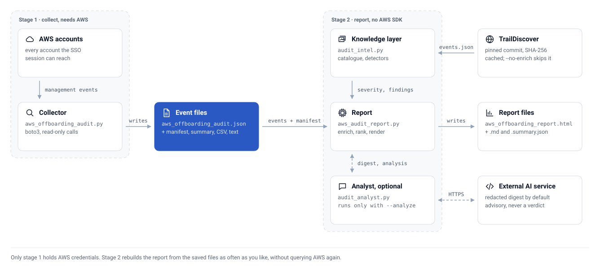

# How it works

The tool runs in two stages joined by a JSON file, so you can rebuild a report without querying AWS again.

<picture>
  <source media="(prefers-color-scheme: dark)" srcset="assets/pipeline-dark.svg">
  
</picture>

## Stage 1: collect

`src/aws_offboarding_audit.py` signs in to each reachable account through IAM Identity Center with short-lived role credentials. It calls CloudTrail `LookupEvents` per account and region and keeps events that match the person by SSO username, session ARN, principal ID, IAM user name or Identity Center session issuer. It writes event JSON, a manifest of what was covered, and a checkpoint so an interrupted run can resume.

## Stage 2: report

`src/aws_audit_report.py` reads the event JSON. It never calls AWS. For each event it assigns three separate facts:

| Signal | Meaning |
|---|---|
| Intrinsic severity | What the API action can do |
| Timing severity | Whether it happened during notice or after the last working day |
| Current state | Whether the affected resource or access still exists (needs the optional state file) |

It then inspects request parameters for external trust, wildcard policies, public resources, long-lived credentials, open security groups, destructive lifecycle rules and logging changes, links ordered activity from the same principal, account and target, and computes a 1 to 10 review priority locally.

## Optional inputs

| Input | Flag | What it adds |
|---|---|---|
| Current state | `--state` | Whether flagged changes still exist, from `src/aws_current_state.py` |
| Peer baseline | `--baseline` | How the person's activity compares with comparable collections, from `src/audit_baseline.py` |
| Event catalogue | on by default | Pinned TrailDiscover descriptions and MITRE tactics; `--no-enrich` skips it |
| External analysis | `--analyze` | A schema-validated, advisory interpretation of the findings digest |

## Why two stages

Collection is slow and throttled. Reporting is fast and repeatable. Keeping them apart means you can tune severity, add a baseline or re-run the analysis without another collection, and the report stage runs on a bare Python install with no AWS SDK.

For the severity model, detector internals and extension points, read [Explanation: architecture](explanation-architecture.md).
